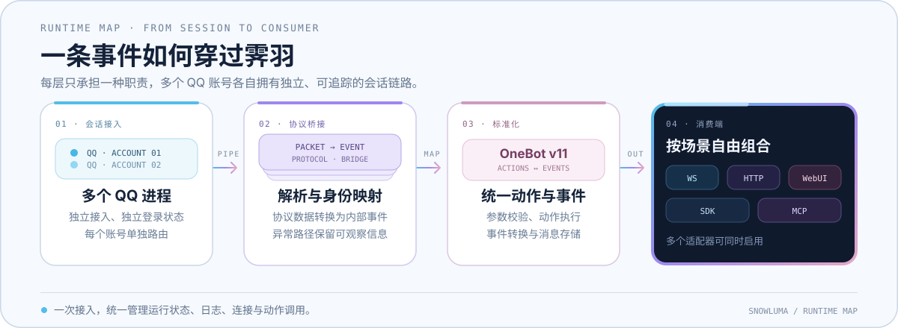

# 霁羽 · Jiyu<picture></picture>

**雪霁捎信，连接不止。**

霁羽是基于 SnowLuma 源码继续开发的 QQ 客户端 TypeScript 互操作运行时。<br>
OneBot v11 · WebUI · SDK · MCP

「霁」是风雪后的晴光，「羽」是继续传递消息的信使。霁羽为独立维护的接力项目，并非 SnowLuma 官方后继项目；感谢原项目作者与贡献者。

将 QQ 原生会话转换为 [OneBot v11](https://github.com/botuniverse/onebot-11) 动作与事件，通过 WebSocket、HTTP、WebUI、SDK 和 MCP 提供统一入口。

多账号会话、消息与媒体、连接配置和实时日志，在一个运行时中管理。

**[项目仓库](https://github.com/shizukugo/Jiyu)** · **[快速开始](#快速开始)** · **[独立协议研发进展](packages/protocol/DIRECT_PROTOCOL.md)**<br>
[原项目部署指南](https://snowluma.github.io/zh/docs/guide/deploy) · [原项目动作参考](https://snowluma.github.io/zh/docs/api)

目前运行时仍通过 QQ 客户端接入；不依赖客户端或 Hook 的独立协议正在研发。现有离线组件已覆盖部分协议封包和扫码数据处理，但独立登录及运行时接入尚未完成。

<sub>Windows x64 · Linux x64 / arm64</sub>

<br clear="both" />

> [!CAUTION]
> SnowLuma 是独立的第三方项目，与腾讯 / QQ 无隶属或授权关系。项目仅供学习与技术研究，请遵守《QQ 用户协议》及适用法律；软件按“现状”提供，使用风险自负。详见 [`EULA.md`](EULA.md)。
>
> **Disclaimer:** SnowLuma is independent of Tencent / QQ and is provided for study and research only, “as is” and without warranty.

## 核心能力

| 场景 | 能力 |
| --- | --- |
| OneBot 接入 | OneBot v11 动作与事件；WebSocket 服务端 / 客户端及 HTTP 服务端 / 上报 |
| 消息与媒体 | 文本、图片、语音、视频、文件、回复、提及、转发及常见卡片 |
| 多账号运行 | 各账号独立维护会话、身份映射、消息存储和网络配置 |
| WebUI 管理 | 账号状态、实时日志、连接配置、动作调试和存储管理 |
| 开发者工具 | [`@snowluma/sdk`](packages/sdk/README.md) 与 [`@snowluma/mcp`](packages/mcp/README.md) |

## 运行链路

下图沿用原项目的运行链路示意；图中的 SnowLuma 指本项目所继承的现有架构。

<p align="center">
  
</p>

会话接入、协议解析、身份映射、OneBot 转换和网络适配保持独立边界；多个 QQ 账号可并行运行。

## 快速开始

1. 在项目根目录使用 Node.js 24.22.1（或项目支持的其他版本）和 pnpm 11.25.0 构建：

   ```bash
   git clone https://github.com/shizukugo/Jiyu.git
   cd Jiyu
   pnpm install --frozen-lockfile
   pnpm run build:all
   ```

2. 进入生成的 `dist` 目录。Windows 运行 `launcher.bat`；Linux 执行：

   ```bash
   chmod +x launcher.sh
   ./launcher.sh
   ```

3. 打开 [`http://localhost:5099`](http://localhost:5099)，使用启动日志中的初始密码登录 WebUI，按引导接入 QQ 进程并配置 OneBot 连接。

霁羽的发行包尚未发布；历史上游链接仅供参考。

账号识别由登录数据库的文件变化、进程和登录事件或手动操作触发，不做周期探测。未载入的 QQ 进程也不会持续调用 Windows Restart Manager；需要重查时可点击 WebUI 进程行的刷新/重连。

## 接入与文档

| 入口 | 文档 |
| --- | --- |
| WebSocket / HTTP | [原项目 OneBot 动作参考](https://snowluma.github.io/zh/docs/api) |
| 部署（Docker / Windows） | [原项目部署指南](https://snowluma.github.io/zh/docs/guide/deploy) |
| TypeScript SDK | [`packages/sdk/README.md`](packages/sdk/README.md) |
| MCP | [`packages/mcp/README.md`](packages/mcp/README.md) |

JSON 消息段接受标准的 `data.data` 字符串，也兼容 `data.data` 非数组对象和 `{ type: "json", data: "..." }` 简写；`data` 必填，最终内容必须是 JSON 对象。

## 开发

在项目根目录使用 Node.js 24.22.1 及以上的 24.x，或 Node.js 26.12.1 及以上版本，以及 pnpm 11.25.0：

```bash
pnpm install --frozen-lockfile
pnpm typecheck
pnpm test
```

现阶段源码中的包名、配置项和命令仍沿用 `@snowluma/*` 与 `SNOWLUMA_*`；更名不会改变这些兼容接口。贡献流程见 [`CONTRIBUTING.md`](CONTRIBUTING.md)，开发方向见 [`RoadMap.md`](RoadMap.md)。

## 使用边界与许可

本仓库保留 SnowLuma 的原有著作权、署名及许可声明；项目更名不改变原有源码和原生组件的许可条件。

> [!IMPORTANT]
> SnowLuma 使用**源码可见非商业许可**，不是 OSI 开源许可。源码可用于查看、学习、非商业自托管及私下修改；商业使用，以及公开发布修改版或衍生版，均需事先取得书面授权。

完整条款见 [`LICENSE`](LICENSE)；二进制发行包另受 [`EULA.md`](EULA.md) 与 [`PRIVACY.md`](PRIVACY.md) 约束；商业授权请联系 `motricseven@foxmail.com`。随附的原生附加组件为专有组件，不在源码许可范围内。

SnowLuma is source-available for study and non-commercial self-hosting, but it is not OSI open source. Commercial use and public distribution of modified or derivative versions require prior written permission.

## 社区与鸣谢

霁羽以 SnowLuma 为基础，感谢原项目的作者与贡献者。项目问题可在 [Jiyu Issues](https://github.com/shizukugo/Jiyu/issues) 反馈。

以下为历史上游社区入口，可用性以实际情况为准：

- [原项目问题页](https://github.com/SnowLuma/SnowLuma/issues)
- [原项目 QQ 群](https://qm.qq.com/q/g3UMLpWALe)
- [原项目 Telegram](https://t.me/napcatqq)

项目参考了 [LagrangeV2](https://github.com/LagrangeDev/LagrangeV2) 的协议定义与 [NapCatQQ](https://github.com/NapNeko/NapCatQQ) 的实现思路。

<p align="center">
  <a href="https://github.com/SnowLuma/SnowLuma/graphs/contributors"></a>
</p>
